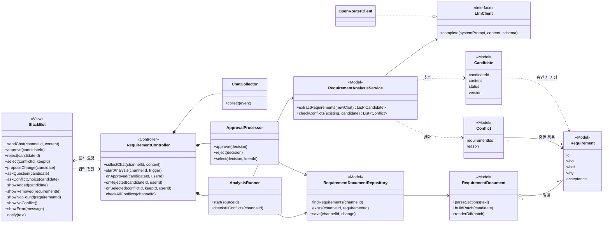
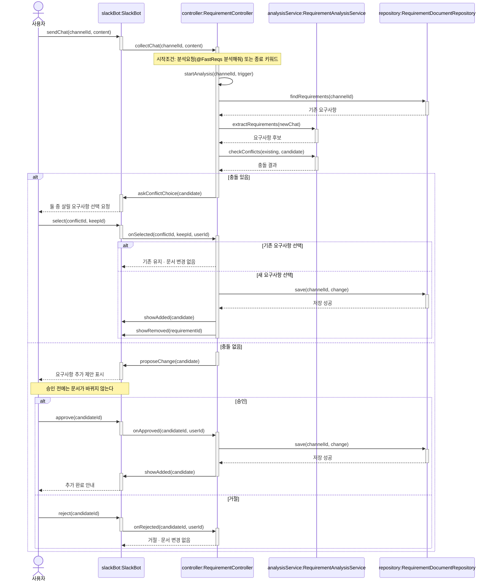
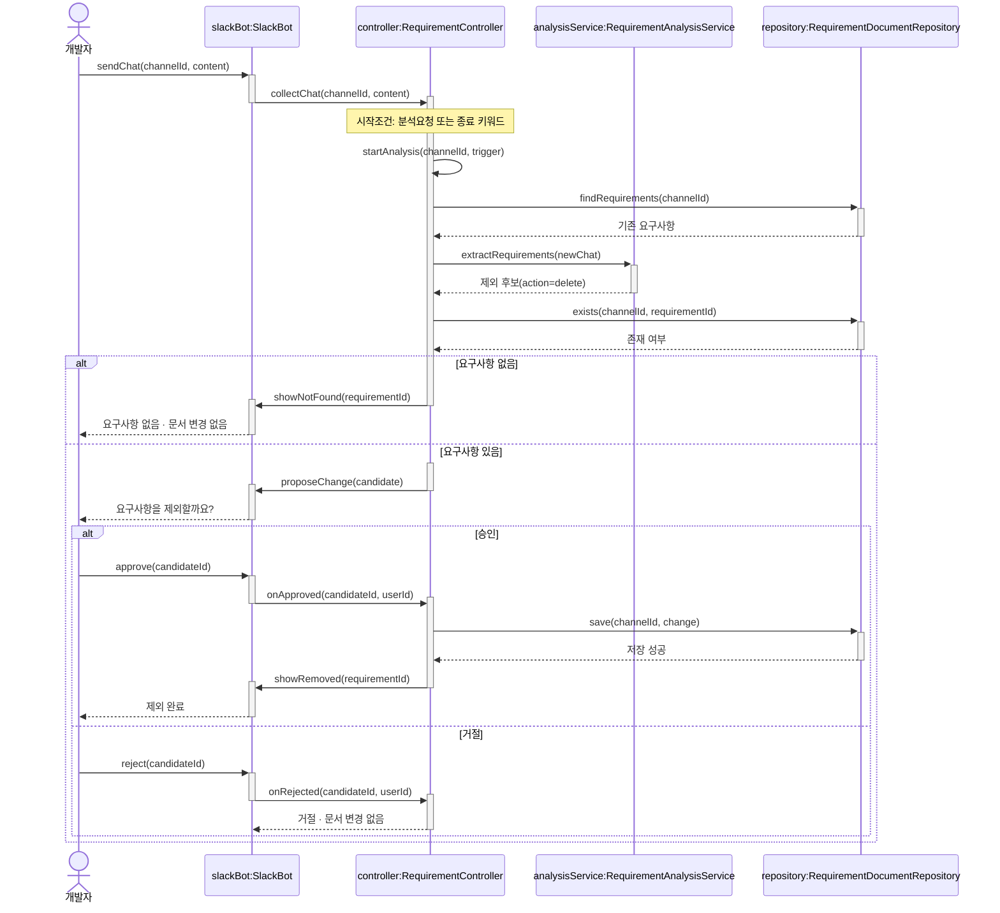
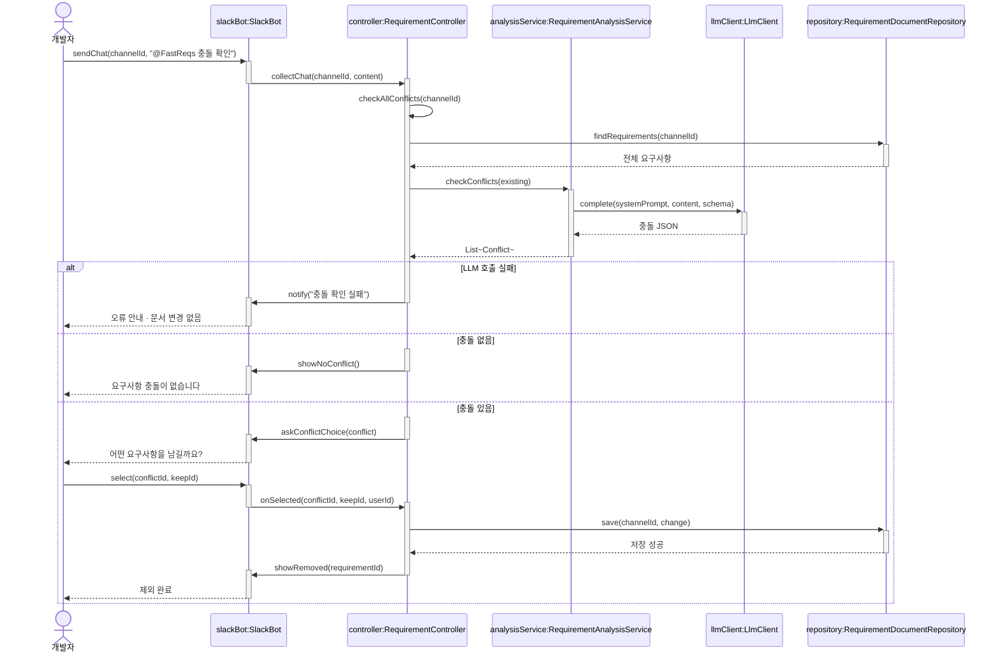

# FastReqs 통합 설계 (UC-01·02·03)

이 문서가 FastReqs 설계의 기준이다. 클래스 이름, 오퍼레이션 이름, 시퀀스 다이어그램은 여기 내용을 따른다.
이 문서 이전의 설계 파일(UC_design.pptx, 클래스목록_시퀀스.pptx, 클래스 다이어그램 hwp)은 내용이 크게 달라 지웠다(git 커밋 2e049c8에 남아 있다). `FastReqs_UI설계(이전).hwpx`는 화면 흐름만 참고하고, 이 문서와 다르면 이 문서를 따른다.
다이어그램 그림 파일(`FastReqs_클래스다이어그램.png`, `FastReqs_시퀀스_UC-0*.png`)은 아래 Mermaid 원본을 렌더링한 것이다.

## 1. 이름 규칙

| 대상 | 규칙 | 예 |
|---|---|---|
| 설계 클래스 | 영문 PascalCase | `RequirementController` |
| 설계 오퍼레이션 | 영문 camelCase, 동사로 시작 | `collectChat(channelId, content)` |
| 코드 클래스 | 설계 클래스 이름 그대로 | `controller.RequirementController` |
| 코드 메서드 | 설계 오퍼레이션을 snake_case로 그대로 옮김 | `collect_chat()` |
| 사용자에게 보이는 문구 | 한국어 | "요구사항 충돌이 없습니다." |
| 시퀀스 객체 헤더 | `objectName:ClassName` | `controller:RequirementController` |

- 액터가 보내는 메시지는 받는 객체의 메서드 이름으로 쓴다: `sendChat`, `approve`, `reject`, `select`.
- 구현 용어(스킬, 명령어 이름 등)를 오퍼레이션 이름에 쓰지 않는다. 이전의 `runConflictSkill()`은 `sendChat("@FastReqs 충돌 확인")`으로 바꿨다.
- 같은 일을 하는 오퍼레이션은 한 클래스에만 둔다. 화면 표시(`showRemoved` 등)는 `SlackBot`에만, 충돌 검사는 `RequirementAnalysisService.checkConflicts`에만, 문서 저장은 `RequirementDocumentRepository.save`에만 있다.

## 2. 용어

| 용어 | 뜻 | 처리 |
|---|---|---|
| 충돌(Conflict) | 두 요구사항을 동시에 만족할 수 없음. 새 후보와 기존 요구사항 사이(UC-01) 또는 기존 요구사항끼리(UC-03) | 선택 질문. 사용자가 고른 하나만 남기고 나머지는 문서에서 제외 |
| 상충 답변 | 보완 질문에 대한 사용자 답변끼리 서로 다름 | 보완 질문(선택형)으로 다시 묻고 승인을 보류 |
| 요구사항 없음 | 수정·삭제 대상 Story가 문서에 없음 | `showNotFound`로 알리고 그 후보는 만들지 않음 |

## 3. 클래스 목록

| 클래스 | 스테레오타입 | 책임 | 오퍼레이션 | 코드 |
|---|---|---|---|---|
| SlackBot | View | Slack 입력을 컨트롤러에 넘기고, 제안·질문·결과를 표시하는 유일한 화면 | sendChat(channelId, content), approve(candidateId), reject(candidateId), select(conflictId, keepId), proposeChange(candidate), askQuestion(candidate), askConflictChoice(candidate), showAdded(candidate), showRemoved(requirementId), showNotFound(requirementId), showNoConflict(), showError(message), notify(text) | `slack_bot.py::SlackBot` |
| RequirementController | Controller | 수집 → 분석 → 충돌 검사 → 제안 → 결정 → 저장 순서를 조정 | collectChat(channelId, content), startAnalysis(channelId, trigger), onApproved(candidateId, userId), onRejected(candidateId, userId), onSelected(conflictId, keepId, userId), checkAllConflicts(channelId) | `controller.py::RequirementController` |
| ChatCollector | Controller 부품 | 대화 저장, 회의록 파일 검사, 시작 조건 판별 | collect(event) | `chat_collector.py::ChatCollector` |
| AnalysisRunner | Controller 부품 | 입력 경로별 분석 실행, 후보 생성, 전체 충돌 확인 | start(sourceId), checkAllConflicts(channelId) | `analysis_runner.py::AnalysisRunner` |
| ApprovalProcessor | Controller 부품 | 승인·거절·충돌 선택 검증, 저장, 재시작 복구 | approve(decision), reject(decision), select(decision, keepId) | `approval_processor.py::ApprovalProcessor` |
| RequirementAnalysisService | Model | 새 대화에서 후보 추출, 요구사항 충돌 검사(유일한 위치) | extractRequirements(newChat): List~Candidate~, checkConflicts(existing, candidate): List~Conflict~ | `analysis_service.py::RequirementAnalysisService` |
| LlmClient | Model(인터페이스) | 외부 LLM 호출 창구. 재시도 1회, Retry-After 존중 | complete(systemPrompt, content, schema) | `ports.py::LlmClient`, `llm_client.py::OpenRouterClient` |
| RequirementDocumentRepository | Model | 채널에 연결된 문서 읽기, 존재 확인, 승인된 변경 저장(추가·수정·삭제 공통) | findRequirements(channelId), exists(channelId, requirementId), save(channelId, change) | `document_repository.py::RequirementDocumentRepository` |
| RequirementDocument | Model | Markdown 문서 구조. 섹션 파싱, 변경 패치, 전후 비교 | parseSections(text), buildPatch(candidate), renderDiff(patch) | `documents.py` |
| Candidate | Model | 승인을 기다리는 변경 후보(후보ID, 내용, 상태, 버전) | - | `records.py::CandidateRecord`, `models.py::Candidate` |
| Requirement | Model | 문서의 요구사항 하나(US ID, Who/What/Why, 인수조건) | - | `models.py::Story` |
| Conflict | Model | 동시에 만족할 수 없는 요구사항 묶음과 이유 | - | `models.py::Conflict` |

이전 설계에서 합친 클래스:

| 이전 | 지금 | 이유 |
|---|---|---|
| DeleteController(UC-02) | RequirementController | 대화 입력 경로를 `collectChat` 하나로. 삭제도 후보의 한 종류(action=delete) |
| DeleteDetector.detectRemoval | RequirementAnalysisService.extractRequirements | 추가·수정·삭제 감지를 한 곳에서 |
| ConflictController(UC-03) | RequirementController.checkAllConflicts | 컨트롤러 하나가 유스케이스 흐름 조정 |
| ConflictDetector.detect | RequirementAnalysisService.checkConflicts | 충돌 검사를 한 곳에서 |
| ConflictView | SlackBot | 화면은 하나. `showRemoved`도 SlackBot에만 |
| RequirementDocument.add / remove | RequirementDocumentRepository.save | 저장 경로를 하나로(작업 저널·롤백 공통) |

## 4. 클래스 다이어그램

컨트롤러는 화면과 분석 서비스를 `ports.py`의 인터페이스(`RequirementView`, `RequirementAnalyzer`)로만 안다. 구체 클래스는 `slack_bot.build_controller()`에서 조립한다(의존관계 역전).

## 5. 시퀀스 다이어그램

공통 표기: 호출은 실선, 반환은 점선, 활성 막대는 실행 중인 구간만 표시한다. 사용자 승인을 기다리는 동안에는 시스템 활성 막대를 그리지 않는다. loop/par는 쓰지 않고 반복 수집은 주석으로 줄인다.

### UC-01 요구사항 추가

- 사전 조건: 사용자가 Slack에 로그인하고 봇이 채널에 있다. 채널과 문서 폴더가 연결되어 있다.
- 정상 흐름: 대화 → 분석 시작 → 문서 조회 → 후보 추출 → 충돌 검사 → 제안 → 승인 → 저장 → 완료 안내.
- 문서 조회를 추출보다 먼저 한다. 추출할 때 기존 Story ID와 내용이 있어야 수정·삭제 대상과 중복을 판단할 수 있기 때문이다.
- 5A 충돌 있음: 선택 질문을 보인다. 기존 요구사항을 고르면 새 후보를 반영하지 않고, 새 요구사항을 고르면 새 후보를 반영하고 충돌한 기존 요구사항을 제외한다.
- 7A 거절: 문서를 바꾸지 않고 끝낸다. 7B 무응답: 승인 대기로 남고 문서는 바뀌지 않는다.
- 생략: 보완 질문(Who/What/Why), Spec/ADR 후속 승인, 회의록 업로드, 저장 실패·재시작 복구.

### UC-02 요구사항 제외

- 시작 조건: Slack에 로그인해 채팅 중이다. 종료 조건: 요구사항 문서에서 해당 요구사항이 제거된다.
- 제외도 후보의 한 종류(action=delete)다. 입력 경로는 UC-01과 같은 `collectChat`이다.
- 4A 요구사항 없음: `showNotFound`로 알리고 끝낸다.

### UC-03 전체 충돌 확인

- 시작: 채널에서 `@FastReqs 충돌 확인`. 문서의 기존 요구사항끼리 충돌을 찾는다.
- 2A 충돌 없음: `showNoConflict`. LLM 호출 실패: 오류를 알리고 문서는 바꾸지 않는다.
- 충돌마다 선택 질문을 보이고, 사용자가 고른 요구사항만 남기고 나머지를 제외한다.

## 6. 설계와 코드의 연결

설계 오퍼레이션과 코드 함수의 전체 대응표는 [리팩토링 보고서](../04-리팩토링/리팩토링보고서.md#설계-모듈과-코드-대응표)에 있다. 모듈별 책임은 [code-architecture](../final/code-architecture.md)를 본다.
