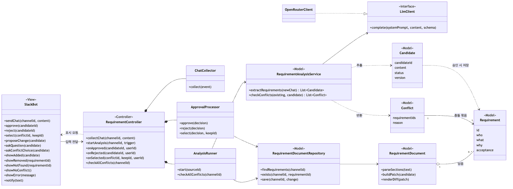

# FastReqs 프로젝트 문서

소프트웨어공학개론 3조 FastReqs: Slack 대화에서 결정된 요구사항을 감지해 User Story·PRD·Spec 문서에 승인/거절 클릭만으로 반영하고, 서로 충돌하는 요구사항은 하나만 고르게 하는 봇.

## 01-요구분석

| 파일 | 내용 |
|---|---|
| [관리계획서.pptx](01-요구분석/관리계획서.pptx) | 프로젝트 관리 계획 |
| [기술조사.pptx](01-요구분석/기술조사.pptx) | Slack Bolt·Events API·LLM·Whisper 기술 타진 |
| [유스케이스다이어그램.pptx](01-요구분석/유스케이스다이어그램.pptx) | 유스케이스 다이어그램 |
| [품질시나리오보고서.pptx](01-요구분석/품질시나리오보고서.pptx) | 품질 시나리오 Q1~Q5 |
| [FastReqs_중간발표.pptx](01-요구분석/FastReqs_중간발표.pptx) | 중간 발표 자료 |

## 02-설계

**기준 설계는 [design.md](02-설계/design.md)다.** 이름 규칙, 클래스 목록, 클래스·시퀀스 다이어그램(UC-01·02·03)이 모두 여기 있다. 아래 pptx/hwp는 그 전 단계의 이력 자료이며 내용이 다르면 design.md를 따른다.

| 파일 | 내용 |
|---|---|
| [design.md](02-설계/design.md) | 통합 설계(기준): 이름 규칙, 클래스 목록, Mermaid 다이어그램 원본 |
| [FastReqs_클래스다이어그램.png](02-설계/FastReqs_클래스다이어그램.png) | 클래스 다이어그램(design.md 렌더링) |
| [FastReqs_시퀀스_UC-01.png](02-설계/FastReqs_시퀀스_UC-01.png) · [UC-02](02-설계/FastReqs_시퀀스_UC-02.png) · [UC-03](02-설계/FastReqs_시퀀스_UC-03.png) | 시퀀스 다이어그램(design.md 렌더링) |
| [UC_design.pptx](02-설계/UC_design.pptx) | (이력) 유스케이스별 시퀀스 다이어그램·클래스 식별, 한국어 오퍼레이션 |
| [클래스목록_시퀀스.pptx](02-설계/클래스목록_시퀀스.pptx) | (이력) 클래스 목록과 시퀀스, 영문 오퍼레이션 |
| [3조 FastReqs 클래스 다이어그램.hwp](02-설계/3조%20FastReqs%20클래스%20다이어그램.hwp) | (이력) 클래스 다이어그램 보고서 |
| [FastReqs_UI설계.hwpx](02-설계/FastReqs_UI설계.hwpx) / [pdf](02-설계/FastReqs_UI설계.pdf) | 실습 na-1 UI 설계: UC-01 요구사항 추가, UC-02 요구사항 제외 화면 스케치 |

## final (요구·동작·저장 설계)

| 파일 | 내용 |
|---|---|
| [prd.md](final/prd.md) | 제품 목적·범위(요구사항 충돌 포함) |
| [user-stories.md](final/user-stories.md) · [spec.md](final/spec.md) | FastReqs 기능 FR-US-001~011 |
| [flow.md](final/flow.md) | 사용자 흐름 |
| [code-architecture.md](final/code-architecture.md) | 설계 클래스 ↔ 코드 모듈 |
| [data-schema.md](final/data-schema.md) | 실제 저장 방식과 상태 |
| [adr.md](final/adr.md) | 기술 결정 FR-ADR-001~006 |
| [mvp-status.md](mvp-status.md) | 구현·검증 상태(이 정보는 여기에만 적는다) |

## 04-리팩토링

| 파일 | 내용 |
|---|---|
| [리팩토링보고서.md](04-리팩토링/리팩토링보고서.md) | 코딩 표준 적용, 코드 스멜·SOLID 점검, 설계 일관성, 설계 모듈 ↔ 코드 대응표 |

## 03-데모

| 파일 | 내용 |
|---|---|
| [FastReqs_데모_2026-11-04.mp4](03-데모/FastReqs_데모_2026-11-04.mp4) | 시나리오 1 회의록으로 월간 보고서 추가, 시나리오 2 다크 모드 삭제 |

