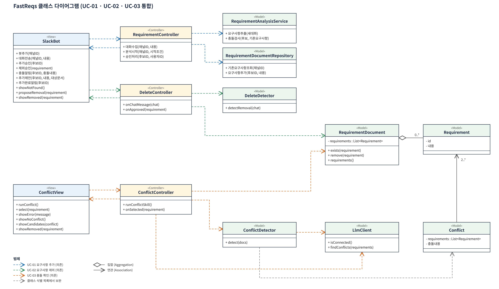

# FastReqs 프로젝트 문서

소프트웨어공학개론 3조 FastReqs: Slack 대화에서 결정된 요구사항을 감지해 User Story·PRD·Spec 문서에 승인/거절 클릭만으로 반영하는 봇.

## 01-요구분석

| 파일 | 내용 |
|---|---|
| [관리계획서.pptx](01-요구분석/관리계획서.pptx) | 프로젝트 관리 계획 |
| [기술조사.pptx](01-요구분석/기술조사.pptx) | Slack Bolt·Events API·LLM·Whisper 기술 타진 |
| [유스케이스다이어그램.pptx](01-요구분석/유스케이스다이어그램.pptx) | 유스케이스 다이어그램 |
| [품질시나리오보고서.pptx](01-요구분석/품질시나리오보고서.pptx) | 품질 시나리오 Q1~Q5 |
| [FastReqs_중간발표.pptx](01-요구분석/FastReqs_중간발표.pptx) | 중간 발표 자료 |

## 02-설계

| 파일 | 내용 |
|---|---|
| [UC_design.pptx](02-설계/UC_design.pptx) | 유스케이스별 시퀀스 다이어그램·클래스 식별 |
| [클래스목록_시퀀스.pptx](02-설계/클래스목록_시퀀스.pptx) | 클래스 목록과 시퀀스 |
| [3조 FastReqs 클래스 다이어그램.hwp](02-설계/3조%20FastReqs%20클래스%20다이어그램.hwp) | 클래스 다이어그램 보고서 |
| [FastReqs_클래스다이어그램.png](02-설계/FastReqs_클래스다이어그램.png) | 클래스 다이어그램 (UC-01·02·03 통합) |
| [FastReqs_UI설계.hwpx](02-설계/FastReqs_UI설계.hwpx) / [pdf](02-설계/FastReqs_UI설계.pdf) | 실습 na-1 UI 설계: UC-01 요구사항 추가, UC-02 요구사항 제외 화면 스케치 |

## 03-데모

| 파일 | 내용 |
|---|---|
| [FastReqs_데모_2026-11-04.mp4](03-데모/FastReqs_데모_2026-11-04.mp4) | 시나리오 1 회의록으로 월간 보고서 추가, 시나리오 2 다크 모드 삭제 |

